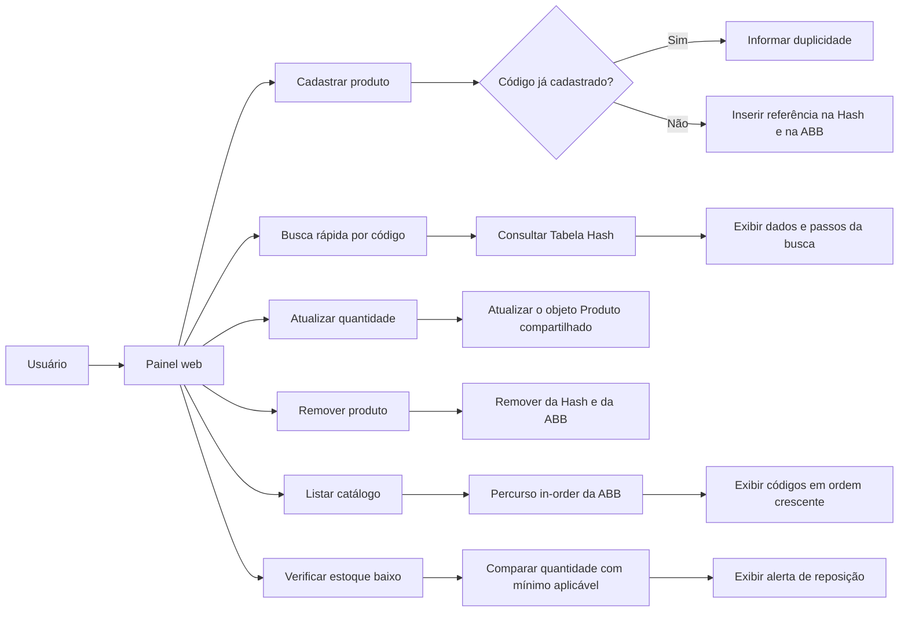
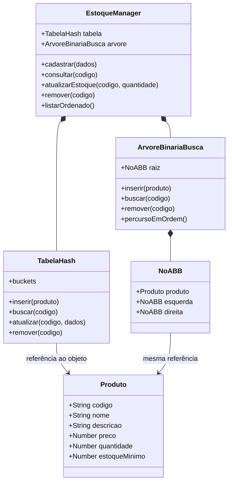
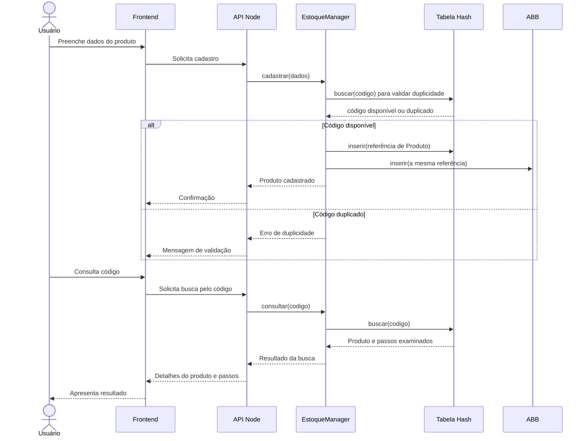

# Sistema de Gerenciamento de Produtos e Estoque

## Visão geral

O projeto planeja um catálogo administrativo de produtos e estoque, inspirado na organização de painéis de e-commerce. Seu objetivo é integrar desenvolvimento web e estruturas de dados: oferecer operações de cadastro e controle de estoque e, ao mesmo tempo, demonstrar como uma tabela hash e uma árvore binária de busca atendem a necessidades diferentes de consulta e ordenação.

Esta etapa define a arquitetura e a documentação. A implementação será iniciada posteriormente pela equipe, a partir desta especificação.

## Objetivos

- Planejar o cadastro, consulta, atualização e remoção de produtos.
- Consultar produtos rapidamente pelo código.
- Listar o catálogo em ordem crescente de código.
- Identificar e alertar sobre produtos abaixo do estoque mínimo.
- Demonstrar a aplicação e os custos das estruturas de dados implementadas manualmente.

## Equipe

- Adones Gomes
- Nicolas Guedes
- Davi Renato

## Stack tecnológica prevista

- **Backend:** Node.js puro e módulos nativos para disponibilizar a API, sem ORM ou banco de dados externo.
- **Armazenamento:** memória do processo, com estruturas de dados próprias.
- **Frontend:** HTML5 semântico, CSS3 responsivo e JavaScript Vanilla ES6+, usando `fetch` para acessar a API.
- **Versionamento:** Git e GitHub.

## Arquitetura planejada

O navegador apresenta o catálogo e os controles administrativos. O JavaScript do frontend enviará solicitações à API HTTP do Node.js. Um serviço `EstoqueManager` coordenará as operações e manterá consistência entre as estruturas.

| Componente | Papel previsto |
|---|---|
| Frontend HTML/CSS/JS | Exibir produtos, formulários, estado do estoque e alertas; enviar operações à API |
| API Node.js | Receber e validar solicitações HTTP e devolver respostas ao frontend |
| `EstoqueManager` | Coordenar cadastro, consulta, atualização, remoção e configuração de estoque mínimo |
| Tabela Hash | Indexar pelo código para detectar duplicidade e realizar busca rápida |
| ABB | Organizar os códigos e fornecer listagem crescente pelo percurso *in-order* |
| `Produto` | Representar código, nome, descrição, preço, quantidade e estoque mínimo |

As estruturas deverão guardar referências para o mesmo objeto `Produto`, sem duplicar os dados. O código do produto será a chave da Tabela Hash e a chave de ordenação da ABB. A Hash usará encadeamento separado para tratar colisões. A ABB não é auto-balanceada; portanto, seu custo depende da forma da árvore.

## Funcionalidades planejadas

1. Cadastrar produto, validando os campos e verificando duplicidade pela Tabela Hash.
2. Consultar produto por código pela Tabela Hash e apresentar detalhes e passos da busca para fins didáticos.
3. Atualizar a quantidade em estoque por código.
4. Remover um produto de ambas as estruturas.
5. Listar todos os produtos em ordem crescente de código pelo percurso *in-order* da ABB.
6. Definir quantidade mínima global e/ou por produto e alertar quando a quantidade estiver abaixo do limite aplicável.

## Complexidade assintótica prevista

| Operação | Tabela Hash (encadeamento separado) | ABB |
|---|---:|---:|
| Cadastro/inserção | O(1) médio para localizar/inserir no bucket; O(n) no pior caso de colisões | O(log n) em árvore balanceada; O(n) no pior caso |
| Consulta por código | O(1) médio; O(n) no pior caso | O(log n) em árvore balanceada; O(n) no pior caso |
| Atualização por código | O(1) médio; O(n) no pior caso | O(log n) em árvore balanceada; O(n) no pior caso |
| Remoção por código | O(1) médio; O(n) no pior caso | O(log n) em árvore balanceada; O(n) no pior caso |
| Listagem crescente | O(n) para percorrer todos os buckets, sem garantia de ordenação | O(n) pelo percurso *in-order* |

`n` representa a quantidade de produtos. A ABB especificada não se auto-balanceia: O(log n) descreve o caso balanceado, e não uma garantia para qualquer entrada.

## Diagramas principais

### Casos de uso e fluxo funcional

### Classes e objetos compartilhados

### Sequência de cadastro e consulta

Para os diagramas detalhados de entidades, arquitetura cliente-servidor e fluxos internos das estruturas, consulte [docs/MODELAGEM_MERMAID.md](docs/MODELAGEM_MERMAID.md).

## Governança de IA

Todo prompt enviado a ferramentas de IA para este projeto deverá ser registrado em [docs/AI_PROMPTS.md](docs/AI_PROMPTS.md), com data, autor, ferramenta, objetivo, arquivos resultantes e o texto literal do prompt.
