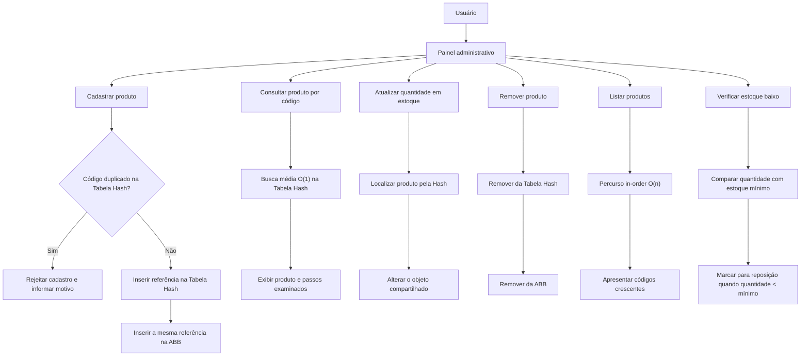
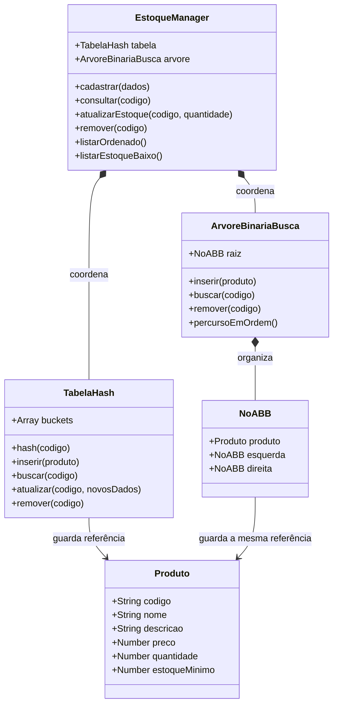
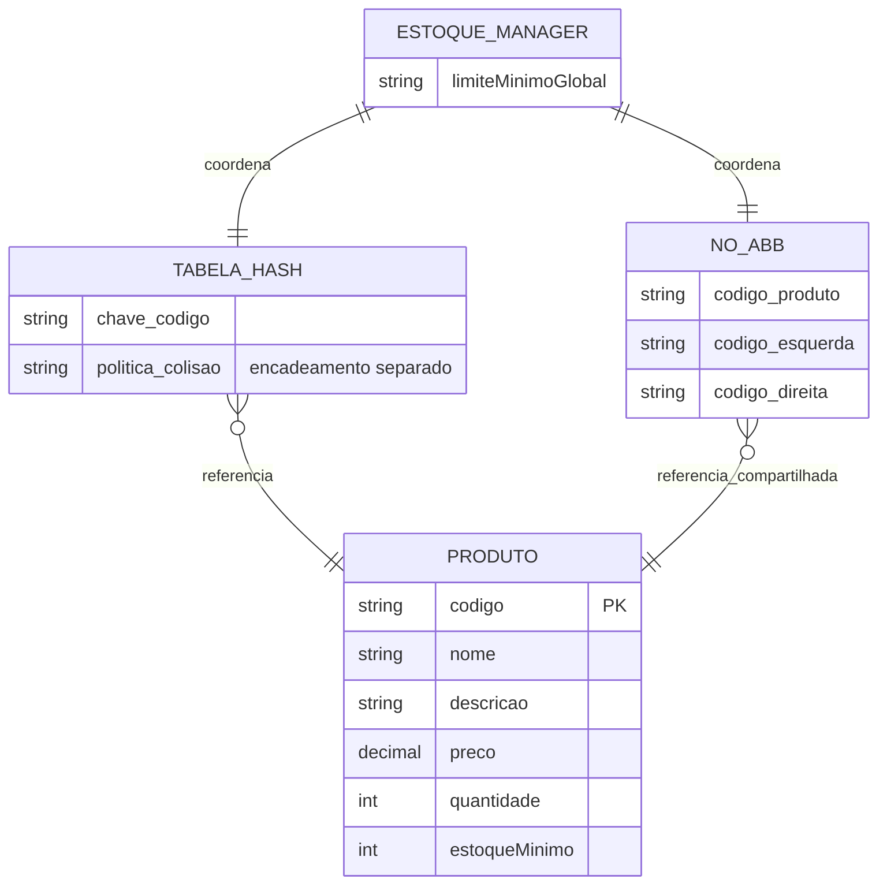
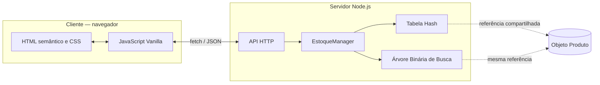
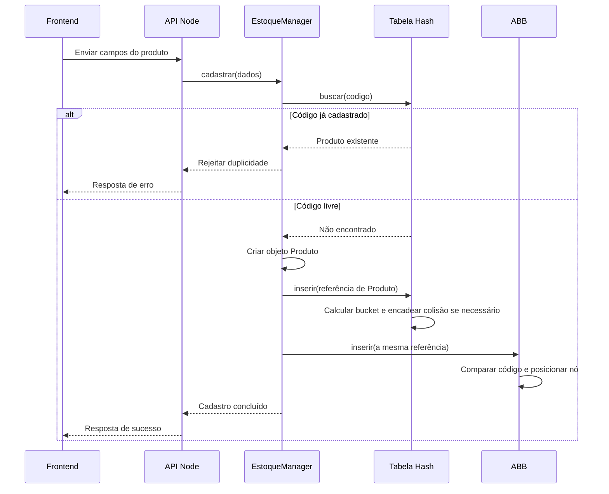
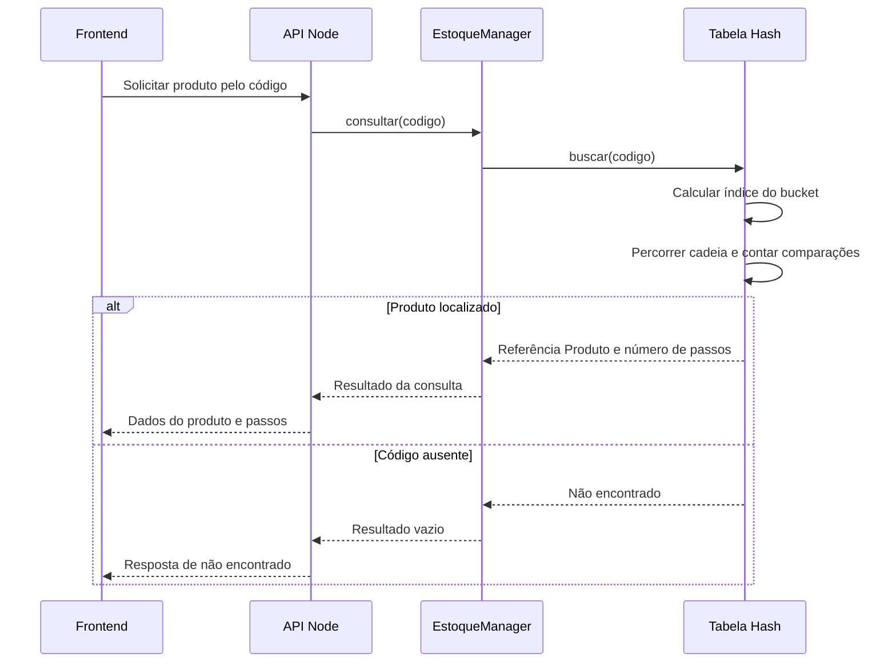
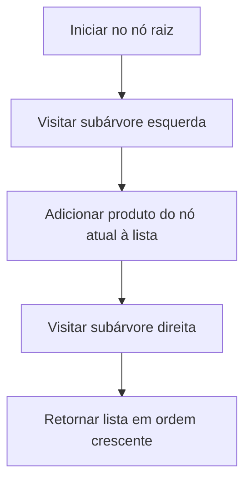
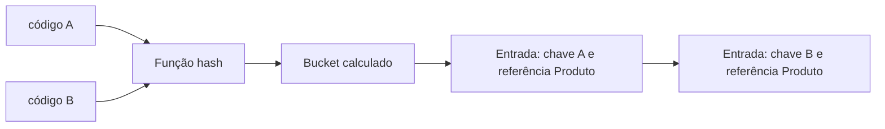

# Modelagem e fluxos Mermaid

Este documento reúne diagramas previstos para a revisão arquitetural e para a documentação do desenvolvimento. Os diagramas representam o comportamento planejado, não uma implementação existente.

## 1. Casos de uso e fluxo funcional

## 2. Diagrama de classes e referências

## 3. Modelo de entidades

As ligações com `PRODUTO` representam referências em memória ao objeto, não cópias ou tabelas de banco de dados.

## 4. Arquitetura cliente-servidor

O Node.js servirá a API e, conforme a organização de implantação definida pela equipe, poderá servir também os arquivos estáticos do frontend. Os dados residirão na memória do processo; não há persistência após reiniciar o servidor prevista nesta arquitetura.

## 5. Fluxo interno de cadastro na Tabela Hash e na ABB

## 6. Fluxo interno de consulta por código

## 7. Percurso in-order da ABB

Para uma árvore com `n` nós, o percurso visita cada nó uma vez: **O(n)**. Inserção, busca e remoção custam **O(log n)** em uma árvore balanceada e **O(n)** no pior caso de uma ABB degenerada.

## 8. Tratamento de colisões por encadeamento separado

Entradas que produzem o mesmo índice permanecem encadeadas no mesmo bucket. A busca compara os códigos da cadeia correspondente. A complexidade esperada é **O(1)** com distribuição adequada e fator de carga controlado; no pior caso, todas as entradas podem cair no mesmo bucket, levando a **O(n)**.
