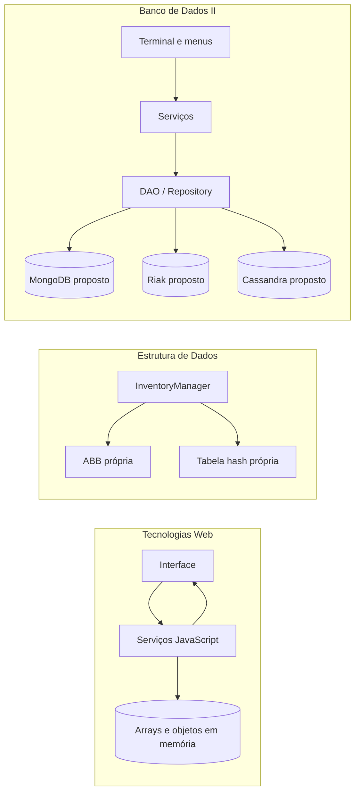
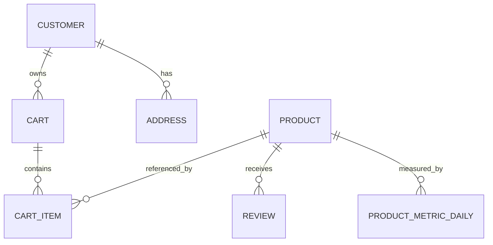
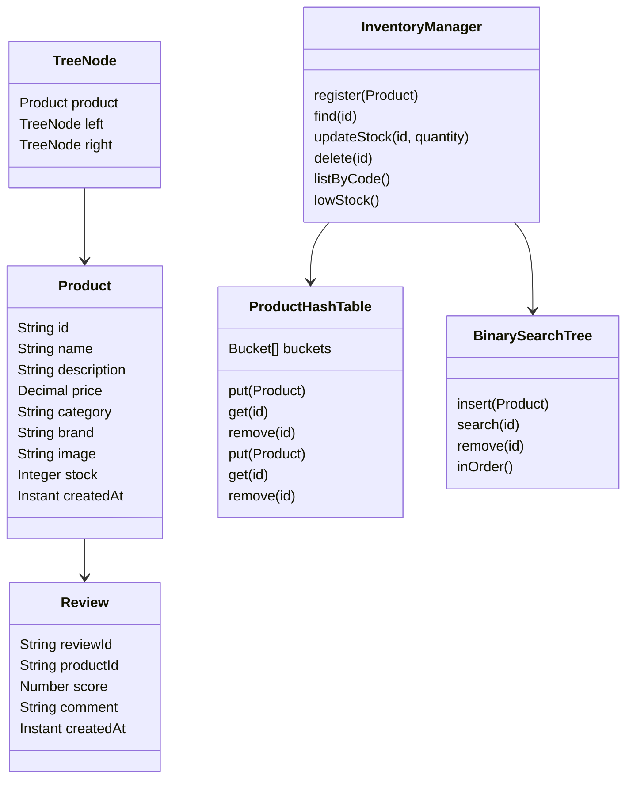
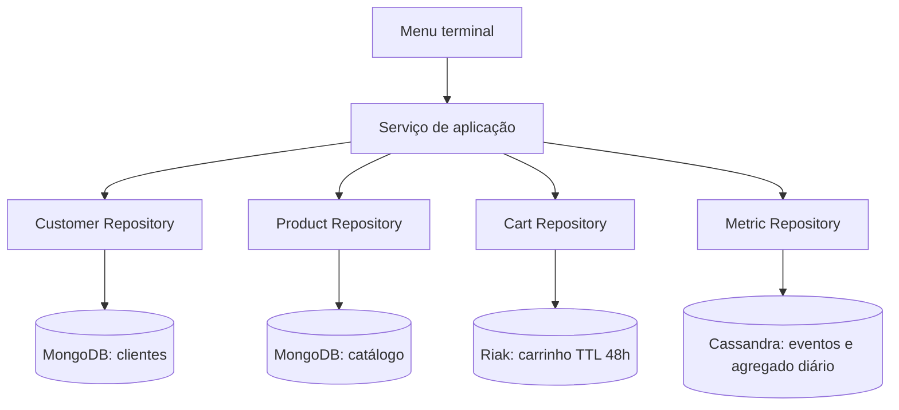

# Diagramas do AmazOFF

Os diagramas abaixo resumem a separação por disciplina. A especificação detalhada de entidades, atributos, operações, agregados e pendências está em [`specification/README.md`](specification/README.md). A distribuição de bancos permanece proposta até aprovação.

## Entregas separadas

## Modelo conceitual

Cada `productId` em Review, CartItem e métricas referencia exatamente `Product.id`. Em Estrutura de Dados, a chave “código” da busca é o próprio `Product.id`, sem outro atributo identificador.

### Entidades e atributos do domínio

O identificador interno de todo produto é unicamente `Product.id`. Na atividade ED, a expressão “código do produto” refere-se ao mesmo `id`, usado como chave da ABB e da tabela hash. Não existe campo `codigo` adicional. Referências como `productId` abaixo armazenam o valor de `Product.id`; não são uma segunda identidade.

| Entidade | Responsabilidade | Identificador e atributos (tipos lógicos) | Relacionamentos |
|---|---|---|---|
| Product | Dados comuns do catálogo e estoque | `id: String` (representação técnica pendente); `name: String`; `description: String`; `price: Decimal`; `category/categoryId: String`; `brand: String`; `image: String`; `stock: Integer`; `createdAt: Instant`; `soldQuantity: Long` (BD); reviews/average derivados ou associados | 1 Product recebe 0..N Review; pode ser referenciado por CartItem e métricas. |
| Review | Nota e comentário de um produto | `reviewId: String`; `productId: Product.id`; `score: Decimal/Integer`; `comment: String`; `createdAt: Instant` | Cada Review pertence a exatamente um Product. Escala de nota pendente. |
| Customer | Cadastro e dados de acesso | `customerId: String`; `email: String`; `passwordHash: String`; `accessData: Map<String,String>`; `createdAt/updatedAt: Instant` | 1 Customer tem 0..N Address e pode ter 0..N Cart (históricos). |
| Address | Endereço de entrega do cliente | `addressId: String`; destinatário, rua, número, complemento?, bairro, cidade, estado, CEP, país, instruções? (`String`) | Pertence a um Customer; cardinalidade 0..N. Campos exatos ainda são recomendação. |
| Cart | Agregado efêmero associado ao cliente, TTL 48h | `cartId: String`; `customerId: String`; `createdAt/updatedAt/expiresAt: Instant`; `items: CartItem[]`; `status: ACTIVE/EXPIRED` (derivado) | Um Customer possui carrinhos; acesso rápido por cliente. Não exige durabilidade permanente. |
| CartItem | Produto, quantidade e preço no carrinho | `productId: Product.id`; `quantity: Integer`; `unitPrice: Decimal`; `productNameSnapshot?: String` | Interno a exatamente um Cart; referencia um Product por id; snapshot de preço/política pendentes. |
| ProductMetricEvent | Ocorrência de visualização, adição ou remoção | `eventId: String`; `productId: Product.id`; `eventType: VIEW/ADD/REMOVE`; `occurredAt: Instant`; `quantity?: Integer`; `windowStart: Instant` | Cada evento refere-se a um Product; identidade de usuário não é necessária para a contagem global transcrita. |
| ProductMetricDaily | Contadores agregados por produto e janela de 24h | `productId: Product.id`; `dayUtc: LocalDate`; `views/cartAdds/cartRemovals: Long`; `aggregatedAt: Instant` | Projeção de eventos de um Product numa janela diária; não representa quantidade vendida. |

`averageRating`, `subtotal` e total do carrinho são valores derivados das avaliações/itens; persistir cópias exige política de atualização. `soldQuantity` é exigido no catálogo BD, mas seu significado e relação com estoque ainda precisam ser confirmados. A imutabilidade de `Product.id` após criação é recomendada, mas permanece decisão técnica. `TreeNode`, `HashEntry` e `Bucket` são estruturas internas ED, não entidades persistidas do domínio.

## Estruturas ED

## Fluxos de persistência BD propostos

MongoDB/Riak/Cassandra são uma recomendação de distribuição, sujeita à escolha de ao menos dois bancos e justificativa da equipe. Não há API REST obrigatória na especificação transcrita. A configuração Spring Boot do projeto Gradle não representa, sozinha, a entrega BD concluída.
