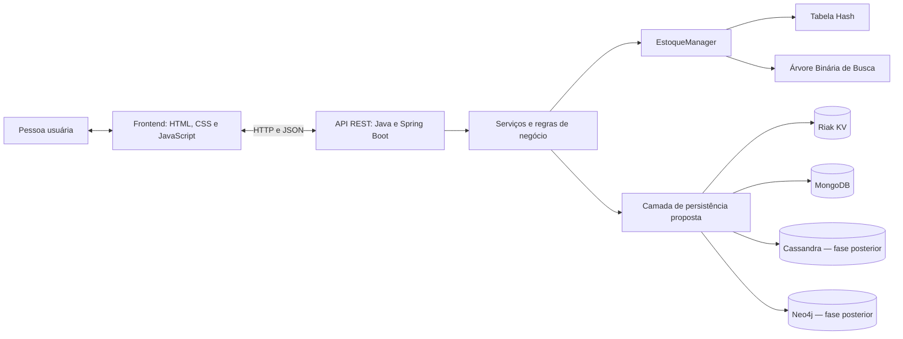
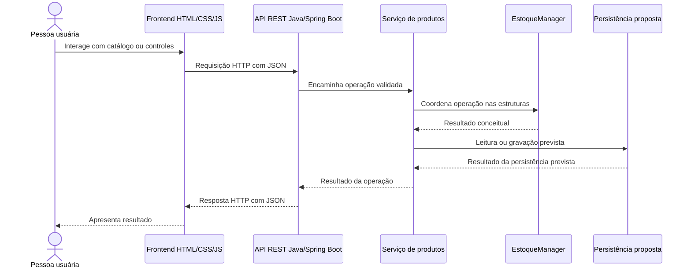
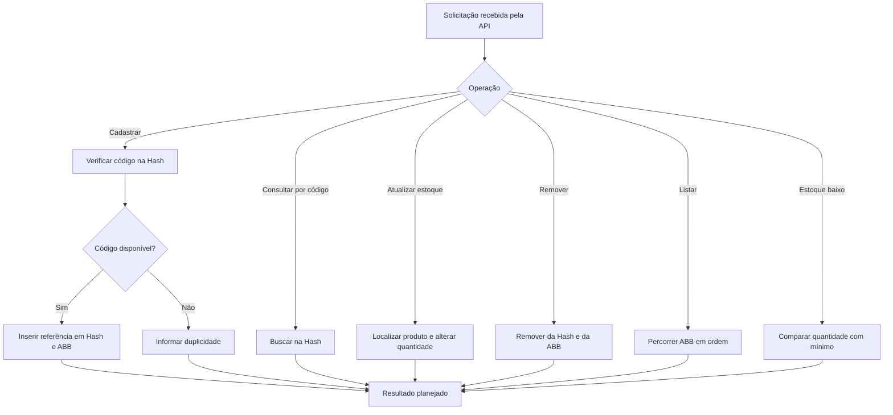
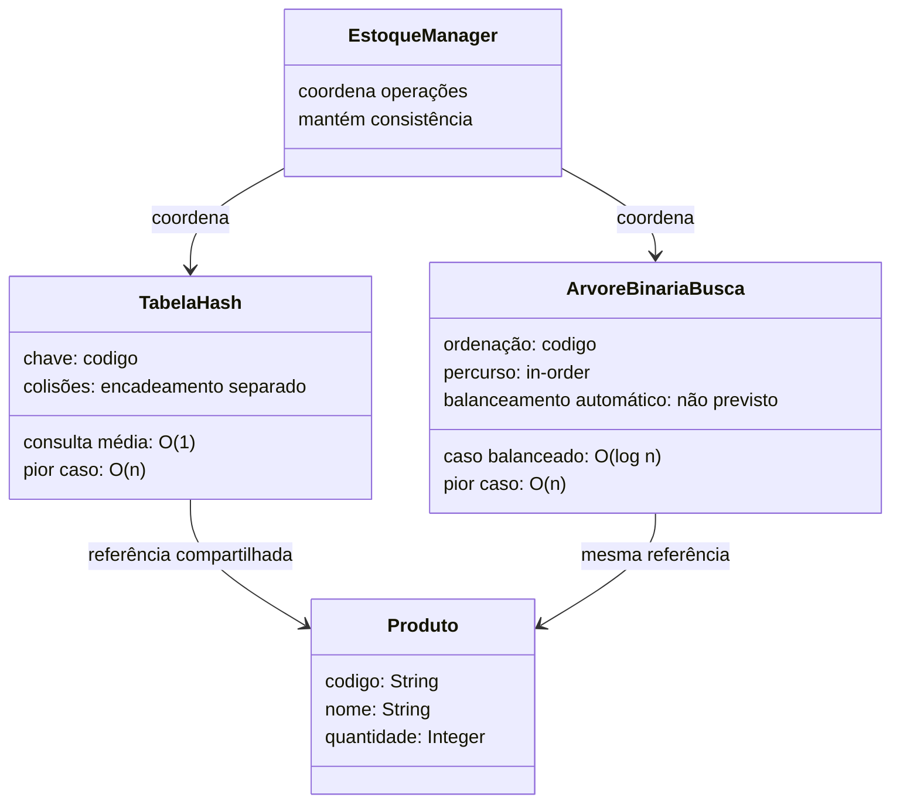
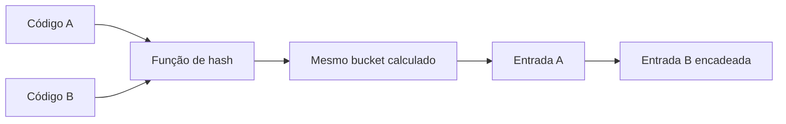
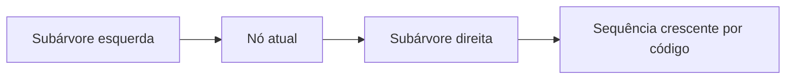
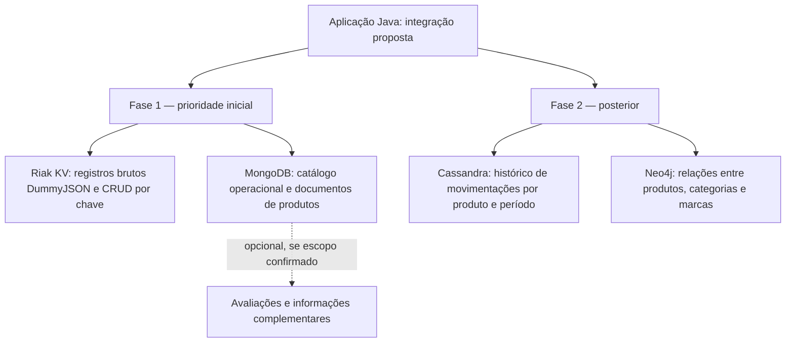

# Diagramas conceituais do AmazOFF

Este documento reúne diagramas de arquitetura e estruturas de dados previstos para apoiar a discussão e a implementação futura. Eles descrevem propostas e não comprovam funcionalidades implementadas. A separação entre os bancos é uma hipótese inicial sujeita à validação acadêmica.

## 1. Arquitetura geral

## 2. Comunicação frontend/backend

O fluxo representa uma comunicação planejada. Serviços, persistência e integração não são declarados como concluídos.

## 3. Fluxo de gerenciamento de produtos

## 4. Organização conceitual das estruturas de dados

A listagem crescente pela ABB percorre `n` nós e custa O(n). As duas estruturas devem apontar para o mesmo objeto Produto para evitar divergência de dados.

### Colisões na Tabela Hash

Com distribuição adequada, a consulta esperada é O(1); no pior caso, uma cadeia com todas as `n` entradas resulta em O(n).

### Percurso in-order da ABB

## 5. Organização conceitual dos bancos

As responsabilidades dos quatro bancos são hipóteses arquiteturais, não requisitos aprovados. As especificações do professor de Banco de Dados II ainda serão recebidas.

## Histórico conceitual

A primeira modelagem usava Node.js e armazenamento apenas em memória para ilustrar a Hash e a ABB. Essa etapa conceitual permanece registrada, mas a arquitetura atualmente planejada considera backend Java/Spring Boot e persistência NoSQL. A mudança de proposta não altera os conceitos didáticos das estruturas: suas complexidades e a necessidade de manter referências compartilhadas continuam documentadas.
