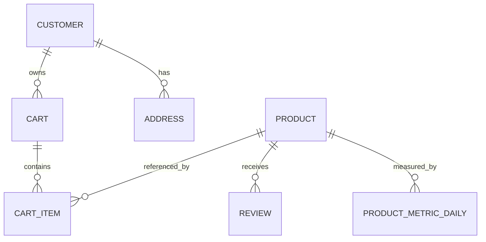
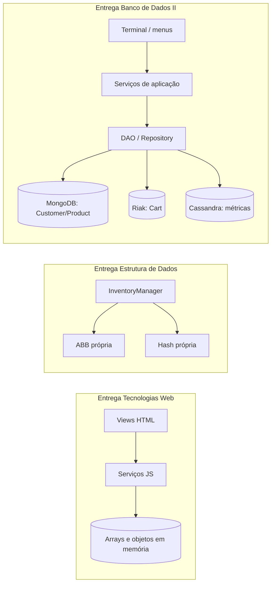

# Especificação integrada do AmazOFF

## 1. Finalidade e proveniência

Este documento consolida a especificação funcional e técnica das três disciplinas, preservando suas entregas separadas. A fonte oficial disponível para esta consolidação é o conteúdo transcrito pela equipe na solicitação de auditoria: requisitos de Tecnologias Web, Projeto 3 de Estrutura de Dados e Algoritmos e Aplicação Azul de Banco de Dados II. Os arquivos citados como anexos (`06_amazoff(2).pdf` e `[2026.2] PROJETO - Persistência poliglota orientada a agregados com NoSQL(1).docx`) não estão no repositório; conferir as transcrições contra os originais é uma pendência documental.

Convenções: **OFICIAL** identifica requisito transcrito da disciplina; **DECISÃO DE PROJETO** identifica regra necessária para tornar o requisito implementável, sujeita à aprovação quando indicada; **RECOMENDAÇÃO** não altera o escopo oficial.

## 2. Limites entre disciplinas

| Disciplina | Entrega e armazenamento | Responsabilidade própria |
|---|---|---|
| Tecnologias Web (TW) | Aplicação web em JavaScript; registros em arrays e objetos em memória; atualização dinâmica da interface. Sem backend, banco ou autenticação nesta entrega. | CRUD, catálogo, detalhes, pesquisa, filtros, avaliações, comentários e média conforme esta etapa. |
| Estrutura de Dados e Algoritmos (ED) | Sistema de estoque com ABB e tabela hash implementadas pelo grupo. A linguagem e a integração com outras entregas não estão especificadas na transcrição. | Cadastro, busca por código, atualização de estoque, remoção, ordenação crescente e alerta de estoque baixo. |
| Banco de Dados II (BD) | Aplicação Java com Gradle, interface de terminal, DAO/Repository e ao menos dois bancos permitidos simultaneamente em localhost:porta. | E-commerce Azul orientado a agregados: clientes, catálogo, carrinhos efêmeros e métricas agregadas. |

Compartilhar conceitos e nomes de domínio não faz uma entrega satisfazer automaticamente outra. A aplicação BD não é backend exigido para TW. ABB/hash não substituem persistência BD; banco algum substitui as estruturas obrigatórias ED. O projeto Java em `amazoff-backend/` permanece na localização existente e agora usa Gradle; a configuração Spring Boot foi preservada, mas não prova sozinha atendimento a menus de terminal e persistência poliglota.

## 3. Requisitos por disciplina

### 3.1 Tecnologias Web — requisitos oficiais

| ID | Requisito | Critério de aceitação verificável |
|---|---|---|
| TW-01 | Cadastrar produto | Submeter os campos do produto e vê-lo no estado em memória e catálogo, sem recarregar a página. |
| TW-02 | Editar produto | Alterar produto existente e ver os dados atualizados no catálogo/detalhe; inexistente não é apresentado como sucesso. |
| TW-03 | Excluir produto | Remover produto existente do estado e da interface; inexistente não é apresentado como sucesso. |
| TW-04 | Exibir catálogo | Mostrar produtos do estado corrente em cartões/lista. |
| TW-05 | Exibir dados do catálogo | Cada cartão mostra nome, preço, imagem, categoria e marca; ausência de imagem tem estado visual definido na implementação. |
| TW-06 | Acessar/exibir detalhe completo | Selecionar produto abre detalhe com todos os atributos definidos no modelo TW. |
| TW-07 | Pesquisar por nome | Consulta por nome reduz os resultados conforme a regra de comparação documentada na seção 4. |
| TW-08 | Filtrar por categoria | Seleção de categoria mostra somente produtos daquela categoria; filtro pode ser removido. |
| TW-09 | Registrar nota e comentário | Criar avaliação vinculada ao produto e refletir a nova avaliação no estado em memória. |
| TW-10 | Visualizar avaliações | Detalhe lista as avaliações daquele produto, incluindo nota, comentário e data. |
| TW-11 | Exibir média | Média corresponde às notas existentes; sem avaliações apresenta estado “sem avaliações”, não uma média fictícia. |
| TW-12 | Tela de catálogo | Existe tela/visão de catálogo utilizável. |
| TW-13 | Tela de cadastro | Existe formulário para TW-01. |
| TW-14 | Tela de edição | Existe formulário preenchido para TW-02. |
| TW-15 | Tela de detalhes | Existe tela/visão para TW-06 e TW-10. |
| TW-16 | Tela de avaliação | Existe fluxo/tela para TW-09. |
| TW-17 | Atualização dinâmica e armazenamento em memória | Operações alteram arrays/objetos JavaScript e atualizam interface dinamicamente; recarga/persistência não é exigida. |

Os critérios acima operacionalizam a transcrição da disciplina. Validações de domínio ainda não fornecidas (por exemplo escala da nota e campos obrigatórios) constam como pendências, não são requisitos oficiais presumidos.

### 3.2 Estrutura de Dados e Algoritmos — requisitos oficiais

| ID | Requisito | Critério de aceitação verificável |
|---|---|---|
| ED-01 | Cadastrar produto | Produto é inserido na ABB e hash por `Product.id`; id duplicado é recusado sem alterar estado. |
| ED-02 | Consultar por código (`Product.id`) | Hash devolve o produto associado ao id; inexistente retorna resultado ausente explícito. |
| ED-03 | Atualizar quantidade em estoque | Produto existente tem quantidade atualizada; quantidade inválida e id ausente não alteram as estruturas. |
| ED-04 | Remover produto | Produto existente é removido da ABB e hash; inexistente retorna resultado ausente explícito. |
| ED-05 | Listar em ordem crescente de `id` (código) | Percurso in-order devolve todos os produtos exatamente uma vez em ordem crescente. |
| ED-06 | Identificar estoque baixo | Comparar quantidade com limite configurado; limite é parâmetro até aprovação de valor oficial. |
| ED-07 | ABB | Implementação própria: inserção, busca, remoção (folha, um filho, dois filhos) e percurso in-order. |
| ED-08 | Tabela hash | Implementação própria com hash determinística e colisões por encadeamento separado. |
| ED-09 | Consistência ABB/hash | Ambas indexam o mesmo produto lógico; operações são atômicas do ponto de vista do módulo ou restauram estado em falha parcial. |

Não usar coleções ordenadas, arrays ou árvores de biblioteca como substitutas da ABB/hash. Coleções auxiliares internas são permitidas apenas se não eliminarem a implementação exigida.

### 3.3 Banco de Dados II — requisitos oficiais transcritos

| ID | Requisito | Critério de aceitação verificável |
|---|---|---|
| BD-01 | Aplicação Azul de e-commerce de grande porte | O domínio e menus simulam as operações descritas nesta seção. |
| BD-02 | Java e Gradle | Projeto da disciplina é uma aplicação Java construída com Gradle. |
| BD-03 | Persistência poliglota orientada a agregados | Integra simultaneamente pelo menos dois entre Riak, MongoDB e Cassandra, com justificativa por agregado. |
| BD-04 | Clientes | Cadastra cliente, atualiza dados de acesso, e-mail, senha e endereços de entrega. |
| BD-05 | Produtos e catálogo | Mantém descrição, avaliações/comentários, quantidade vendida, categorias e estoque; permite busca rápida por categoria e disponibilidade de estoque. |
| BD-06 | Carrinho associado ao cliente | Adiciona/remove produtos, atualiza quantidades e valores; acesso rápido; TTL de 48 horas; não exige durabilidade permanente. |
| BD-07 | Métricas de produto | Registra visualizações, adições e remoções ao carrinho para todos usuários. |
| BD-08 | Agregação de métricas | Agrega as métricas em janelas de 24 horas. A fronteira temporal e o atraso tolerado são decisões a registrar. |
| BD-09 | Arquitetura de dados | Documenta agregados/variantes, associações, eventos de leitura/escrita, opções de menu, banco e justificativa/configuração. |
| BD-10 | Semântica operacional dos bancos | Documenta disponibilidade, consistência, durabilidade, consistência eventual, quóruns, versões/conflitos Riak, chaves Cassandra, shard key/índices MongoDB e estratégia de agregação/materialized views. |
| BD-11 | Aplicação de terminal | Menus executam e demonstram os eventos de leitura e escrita dos agregados. |
| BD-12 | DAO ou Repository | Existem componentes de leitura/escrita para cada agregado e banco utilizado. |
| BD-13 | Bancos locais | Bancos exigidos ficam acessíveis em IP:PORTA padrão sobre localhost. |

## 4. Regras de negócio consolidadas

As regras abaixo distinguem requisito transcrito de recomendação/decisão de projeto. Critérios que dependem de uma pendência são marcados como provisórios e não devem ser tratados como regra oficial adicional.

| ID | Descrição | Disciplina / RF | Entidades | Condição de aplicação | Comportamento esperado | Critério de aceitação |
|---|---|---|---|---|---|---|
| RN-01 | Um produto possui exatamente um `id` único; o “código” de ED é esse mesmo `id`. | TW-01–03, TW-06; ED-01–05; BD-05 | Product | Criar ou localizar produto em qualquer entrega. | Rejeitar duplicidade; referências externas usam valor de Product.id; não criar segundo código. | Busca por id/código retorna o mesmo produto e duplicado não cria segundo registro. |
| RN-02 | Estoque não pode ser negativo. | ED-03, ED-06; BD-05 (consulta de disponibilidade) | Product | Atualização/consulta de estoque. **Regra de projeto recomendada**, confirmar com ED. | Recusar quantidade negativa; não alterar estoque em atualização inválida. | Quantidade negativa não é persistida; saldo consultado corresponde ao valor mantido. |
| RN-03 | Recomenda-se manter `Product.id` imutável após cadastro; confirmar antes de codificar. | TW-01–03, ED-01–05, BD-05 (decisão técnica) | Product e referências | Edição de atributos do produto. | Se aprovada, edição mantém id para preservar referências/índices. | Com a política aprovada, editar outros atributos preserva consulta pelo id anterior; sem aprovação, comportamento fica pendente. |
| RN-04 | Média é soma das notas dividida pela contagem; lista vazia não possui média. | TW-09–11; BD-05 | Review, Product | Exibir agregação de avaliações. | Calcular a partir das notas; representar ausência sem nota/média fabricada. | Média confere com conjunto de avaliações; vazio mostra “sem avaliações”. Escala/arredondamento pendentes. |
| RN-05 | Avaliação contém nota, comentário e data e pertence a um produto. | TW-09–10; BD-05 | Review, Product | Criar/listar avaliação. | Vincular pelo Product.id e apresentar no detalhe daquele produto. | Avaliação de um produto não aparece associada a outro; validação da escala depende de decisão. |
| RN-06 | Carrinho pertence a cliente, tem TTL de 48 horas e não precisa de durabilidade permanente. | BD-06 | Customer, Cart | Abrir, alterar ou expirar carrinho. | Consultas respeitam expiração e o agregado pode ser removido ao vencer. O evento que renova TTL permanece pendente. | Carrinho fica acessível durante o TTL especificado e não após expiração. |
| RN-07 | Item registra produto, quantidade e valor do produto no carrinho. | BD-06 | Cart, CartItem, Product | Adição/remoção/alteração de quantidade. | Quantidade e valor acompanham o item; total pode ser derivado. Preço snapshot e validação de quantidade pendentes. | Ler carrinho devolve os itens/quantidades/valores gravados; regras de preço precisam de aprovação. |
| RN-08 | Registrar visualizações, adições e remoções por produto; agregar a cada 24h entre todos os usuários. | BD-07–08 | ProductMetricEvent, ProductMetricDaily, Product, Cart | Ação correspondente ocorre ou janela de agregação é executada. | Contabilizar cada tipo e produzir total agregado por produto/janela. Janela, deduplicação e semântica de remoção pendentes. | Três tipos são consultáveis e agregação cobre eventos da janela sem perda; regra de reprocessamento precisa ser definida. |
| RN-09 | Segurança de dados de acesso. | BD-04 | Customer | Cadastro/atualização e exibição de credenciais. | Recomendação técnica: nunca guardar/exibir senha em texto simples; algoritmo e requisitos de segurança não foram especificados na transcrição. | Nenhum menu revela senha; armazenamento seguro requer decisão técnica antes de implementar. |
| RN-10 | Disponibilidade de estoque é consulta do saldo; não há requisito transcrito de reserva ou checkout. | BD-05 | Product | Consulta de disponibilidade. | Informar o saldo existente; não inferir reserva, decremento de compra ou fluxo de venda. | Resultado coincide com o atributo de estoque; operações de checkout não aparecem como obrigatórias. |

Busca TW por nome: recomendação inicial é comparação sem distinção de caixa e com trim; tratamento de acentos fica a decidir. Categoria e marca em TW podem ser texto, enquanto BD pode usar identificadores/coleções de valores controlados: não implicam mesma representação física.

## 5. Modelo conceitual integrado

`Product`, `Review` e `Customer` são conceitos compartilháveis. `Cart`/`CartItem` e `ProductMetricDaily` são necessários ao domínio BD e não pertencem por isso automaticamente à entrega Web/ED. A figura mostra associações conceituais; a persistência poderá incorporar subestruturas em agregados.

## 6. Classes/entidades, atributos e responsabilidades

`Product.id` é o identificador único definido pela equipe e é a chave usada em todas as disciplinas. Em ED, “código do produto” significa esse mesmo `id`, nunca um segundo atributo. O tipo concreto, comparação/ordenação e normalização do `id` ainda devem ser escolhidos antes da implementação. Os demais tipos abaixo são contratos lógicos e não obrigam compartilhamento da mesma classe entre JavaScript e Java.

| Classe/entidade | Módulo | Atributos e tipos lógicos | Relações e invariantes |
|---|---|---|---|
| Product | TW, ED, BD (representações próprias) | `id: String` (tipo técnico provisório); `name: String`; `description: String`; `price: Decimal`; `categoryId/category: String`; `brand: String`; `image: String`; `stock: Integer`; `soldQuantity: Long` (BD); `createdAt: Instant`; `reviews: Review[]` ou referência/agregado | Um único `id` é obrigatório e único; é a chave da ABB/hash e referência das demais entidades. Imutabilidade é recomendação pendente. Preço/estoque seguem validações ainda pendentes. Persistência pode diferir. |
| Review | TW, BD | `reviewId: String`; `productId: String`; `score: Decimal/Integer`; `comment: String`; `createdAt: Instant` | Exatamente um Product; escala da nota pendente. |
| Customer | BD | `customerId: String`; `email: String`; `passwordHash: String`; `accessData: Map<String,String>` (campos exatos a definir); `createdAt/updatedAt: Instant` | Endereços pertencem ao agregado Customer ou são subdocumentos; email único é recomendação a confirmar. Nunca guardar senha em claro. |
| Address | BD, subdocumento de Customer | `addressId: String`; `recipient: String`; `street: String`; `number: String`; `complement: String?`; `district: String`; `city: String`; `state: String`; `postalCode: String`; `country: String`; `deliveryInstructions: String?` | Cliente pode ter 0..N endereços; definir endereço padrão como campo/indicador. Campos exatos são recomendação, confirmar. |
| Cart | BD, agregado | `cartId: String`; `customerId: String`; `createdAt: Instant`; `updatedAt: Instant`; `expiresAt: Instant`; `items: CartItem[]`; `status: ACTIVE/EXPIRED` (status derivável de TTL) | Um cliente pode ter 0..N carrinhos históricos; acesso rápido por customerId; dado efêmero, sem durabilidade permanente exigida. |
| CartItem | BD, interno ao Cart | `productId: String`; `quantity: Integer`; `unitPrice: Decimal`; `productNameSnapshot: String?` | Quantidade positiva é validação recomendada a confirmar; subtotal derivado; decisões sobre snapshot pendentes. |
| ProductMetricEvent | BD, evento transitório/lógico | `eventId: String`; `productId: String`; `eventType: VIEW/ADD/REMOVE`; `occurredAt: Instant`; `quantity: Integer?`; `windowStart: Instant` | `eventId` permite deduplicar; identidade do usuário não é exigida para contagem global. Retenção de eventos brutos a decidir. |
| ProductMetricDaily | BD, projeção/agregado | `productId: String`; `dayUtc: LocalDate`; `views: Long`; `cartAdds: Long`; `cartRemovals: Long`; `aggregatedAt: Instant` | Chave lógica produto+dia; atualização incremental ou job de agregação. Métricas não equivalem a `soldQuantity`. |
| TreeNode | ED | `product: Product`; `left: TreeNode?`; `right: TreeNode?` | Ordenação estrita por `Product.id`; nenhum nó duplicado pelo mesmo id. |
| BinarySearchTree | ED | `root: TreeNode?`; `size: Integer` | Implementação própria, sem balanceamento automático requerido. |
| HashEntry / Bucket | ED | `id: Product.id`; `product: Product`; `next: HashEntry?` | Encadeamento separado; chave exatamente igual ao `Product.id`. |
| ProductHashTable | ED | `buckets: Bucket[]`; `capacity: Integer`; `size: Integer`; `loadFactor: Decimal` | Implementação própria; função hash determinística; crescimento/limite de carga é decisão a fixar antes da codificação. |
| InventoryManager | ED | referências a `BinarySearchTree` e `ProductHashTable`; `lowStockThreshold: Integer` | Coordena operações; nenhuma mudança parcial silenciosa entre índices. Nome é recomendação, substitui o provisório `EstoqueManager` apenas se equipe aprovar. |

### 6.1 Operações e assinaturas conceituais — Tecnologias Web

| Componente/método | Parâmetros → retorno | Efeito, regras e erros observáveis |
|---|---|---|
| `ProductStore.create(productInput)` | input → Product | Valida identificador duplicado e dados aceitos; retorna produto; erro de validação/duplicidade. |
| `ProductStore.update(productId, patch)` | id, campos → Product | Altera estado em memória; erro `NOT_FOUND` ou validação. |
| `ProductStore.remove(productId)` | id → boolean | Remove estado; `false` se ausente. |
| `ProductStore.getById(productId)` | id → Product? | Consulta por identidade. |
| `ProductStore.list(filters)` | filtros opcionais → Product[] | Catálogo; filtro de nome/categoria e ordenação conforme decisão de interface. |
| `ReviewService.add(productId, score, comment)` | dados → Review | Exige produto; valida escala quando definida; erro `PRODUCT_NOT_FOUND`/validação. |
| `ReviewService.listByProduct(productId)` | id → Review[] | Avaliações do produto. |
| `ReviewService.average(productId)` | id → Decimal? | Nulo/ausente quando lista vazia; não persistir média duplicada sem política. |
| `CatalogView.render(products)` | Product[] → void | Atualiza DOM sem reload após mutações; erros de renderização devem deixar estado consistente. |

### 6.2 Operações conceituais — Estrutura de Dados

| Componente/método | Parâmetros → retorno | Complexidade e erros |
|---|---|---|
| `BinarySearchTree.insert(product)` | Product → boolean | O(h), O(n) pior; duplicado retorna falso sem mutação. |
| `BinarySearchTree.search(id)` | Product.id → Product? | O(h), O(n) pior; inexistente retorna ausente. |
| `BinarySearchTree.remove(id)` | Product.id → Product? | O(h), O(n) pior; contempla folha/um/dois filhos; ausente retorna ausente. |
| `BinarySearchTree.inOrder()` | — → Product[] | O(n) tempo, O(h) pilha recursiva (ou equivalente iterativo). |
| `ProductHashTable.put(product)` | Product → boolean | O(1) médio esperado, O(n) pior; duplicado não substitui silenciosamente. |
| `ProductHashTable.get(id)` | Product.id → Product? | O(1) médio, O(n) pior com colisões. |
| `ProductHashTable.remove(id)` | Product.id → Product? | O(1) médio, O(n) pior; ausente retorna ausente. |
| `ProductHashTable.resizeIfNeeded()` | — → void | Rehash O(n) quando acionado; política de carga/capacidade pendente. |
| `InventoryManager.register(product)` | Product → Result | Verifica em ambos; rollback se segundo índice falhar; código duplicado erro `DUPLICATE_CODE`. |
| `InventoryManager.find(id)` | Product.id → Product? | Usa hash para busca rápida pelo código/id único. |
| `InventoryManager.updateStock(id, quantity)` | Product.id, Integer → Result | Quantidade válida; altera produto lógico referenciado por ABB/hash; `NOT_FOUND`/validação. |
| `InventoryManager.delete(id)` | Product.id → Result | Remove ambos; falha parcial exige compensação/consistência reparável. |
| `InventoryManager.listByCode()` | — → Product[] | Usa in-order; não ordenar por outra estrutura. |
| `InventoryManager.lowStock()` | — → Product[] | Quantidade abaixo/igual ao limite conforme semântica a aprovar; valor do limite pendente. |

`h` é altura da ABB. Em ABB convencional, busca/inserção/remoção são O(log n) quando altura proporcional a log n e O(n) no pior caso degenerado. Hash tem O(1) esperado sob distribuição adequada e O(n) pior caso. A documentação da disciplina não fixa política de balanceamento, função hash ou redimensionamento; o grupo deve aprovar esses parâmetros antes da implementação.

### 6.3 Operações, serviços e repositórios — Banco de Dados II

Menus mínimos recomendados: clientes (criar/editar/consultar); produtos (criar/editar/consultar, categoria, disponibilidade, avaliações); carrinho (abrir, adicionar, remover, alterar quantidade, consultar); métricas (registrar evento, consultar agregado diário, executar agregação). Eventos devem mostrar resultado ou erro sem expor credenciais.

| Componente | Operações mínimas (assinaturas conceituais) | Responsabilidade |
|---|---|---|
| `CustomerService` | `register(input) → Customer`; `updateAccess(id, patch) → Customer`; `addAddress(id, address) → Address`; `get(id) → Customer?` | Validar comandos de cliente; credenciais protegidas; delegar persistência. |
| `ProductService` | `create(input)`, `update(id, patch)`, `get(id)`, `searchByCategory(category, page)`, `checkAvailability(id)`, `addReview(id, review)`, `getReviews(id)` | Casos de uso do catálogo; não confundir `soldQuantity` com estoque/métrica. |
| `CartService` | `getActive(customerId)`, `add(customerId, productId, qty)`, `remove(customerId, productId)`, `changeQuantity(customerId, productId, qty)`, `expire(now)` | TTL 48h, itens e preço capturado; resultado para expirado/produto ausente/quantidade inválida. Reserva de estoque não incluída. |
| `MetricService` | `record(productId, type, eventId, occurredAt)`, `getDaily(productId, day)`, `aggregate(window) → AggregateResult` | Deduplicação e materialização por janela de 24h; job pode ser acionado por menu na entrega acadêmica. |
| `CustomerRepository` | `save`, `findById`, `findByEmail`, `update` | DAO/Repository do agregado Cliente; escolher implementação MongoDB na proposta. |
| `ProductRepository` | `save`, `findById`, `findByCategory`, `findAvailability`, `update` | DAO/Repository do agregado Produto; MongoDB na proposta. |
| `CartRepository` | `save`, `findActiveByCustomer`, `delete/expire` | DAO/Repository do agregado Carrinho; Riak na proposta; TTL. |
| `MetricRepository` | `appendEvent`, `incrementDaily`, `findDaily`, `aggregateWindow` | DAO/Repository de eventos/projeção; Cassandra na proposta. |

Não há necessidade demonstrada para camada genérica adicional, interfaces de domínio para cada método ou microserviços. Cada implementação de banco deve corresponder ao agregado e aos eventos de leitura/escrita documentados. Erros mínimos a padronizar: não encontrado, duplicidade, dados inválidos, banco indisponível, conflito de versão e carrinho expirado.

#### Estado, relações e dependências dos componentes BD

| Classe/componente | Estado/atributos próprios | Relações | Dependências |
|---|---|---|---|
| `CustomerService` | Sem estado de domínio próprio; comandos/consultas | Coordena Customer e Address | `CustomerRepository` |
| `ProductService` | Sem estado de domínio próprio | Coordena Product, Review e registro de VIEW | `ProductRepository`, `MetricService` |
| `CartService` | Política de TTL/relógio injetável; estado fica em Cart | Coordena Cart/CartItem e eventos ADD/REMOVE | `CartRepository`, `ProductRepository` (saldo/preço conforme política), `MetricService`, `Clock` |
| `MetricService` | Política de janela/deduplicação | Consome ProductMetricEvent e mantém ProductMetricDaily | `MetricRepository`, `ProductRepository` se validar existência |
| `CustomerRepository` / `MongoCustomerRepository` (proposta) | Sem estado de domínio; cliente BSON | Persiste Customer e endereços do agregado | Driver/cliente MongoDB |
| `ProductRepository` / `MongoProductRepository` (proposta) | Sem estado de domínio; produto BSON/índices | Persiste Product e Reviews incorporadas ou associadas | Driver MongoDB, configuração de collection/indexes |
| `CartRepository` / `RiakCartRepository` (proposta) | Sem estado de domínio; chave e codec do Cart | Persiste Cart com TTL e contexto de versão | Cliente Riak, política de conflito |
| `MetricRepository` / `CassandraMetricRepository` (proposta) | Sem estado de domínio; mapeamento de partição | Persiste eventos e projeção diária | Driver Cassandra, keyspace/tabelas |
| `MenuHandlers` / `ConsoleApplication` | Leitores/escritores de terminal; não mantêm domínio | Cada menu invoca um serviço | Serviços e entrada/saída de console |

Implementações nomeadas de banco acima seguem a proposta Mongo/Riak/Cassandra; se a equipe aprovar apenas dois bancos, revisar a coluna, não criar adapters vazios para um banco não usado. Repositories são justificados pelo requisito explícito DAO/Repository; serviços encapsulam casos de uso e menus evitam acesso direto ao banco.

#### Contratos de método a implementar

Os métodos abaixo são assinaturas conceituais Java, não código. `Result<T>` representa sucesso ou erro de domínio; exceções de transporte podem encapsular indisponibilidade. O conjunto exato de campos do input fica sujeito às pendências P-06/P-07.

| Classe/método | Parâmetros → retorno | Regra/efeito | Erros esperados |
|---|---|---|---|
| `CustomerService.register` | `CustomerInput` → `Result<Customer>` | Cria cliente e endereço inicial opcional. | `INVALID_INPUT`, `DUPLICATE_EMAIL` se unicidade aprovada, `STORE_UNAVAILABLE`. |
| `CustomerService.updateAccess` | `customerId`, `AccessPatch` → `Result<Customer>` | Atualiza apenas dados de acesso/e-mail/senha permitidos. | `NOT_FOUND`, `INVALID_INPUT`, `DUPLICATE_EMAIL`, `STORE_UNAVAILABLE`. |
| `CustomerService.addAddress` | `customerId`, `AddressInput` → `Result<Address>` | Acrescenta endereço ao cliente. | `NOT_FOUND`, `INVALID_INPUT`, `STORE_UNAVAILABLE`. |
| `CustomerService.get` | `customerId` → `Result<Customer?>` | Retorna perfil sem credencial secreta. | `STORE_UNAVAILABLE`. |
| `CustomerRepository.save` | `Customer` → `Result<void>` | Insere/substitui agregado pelo ID. | `CONFLICT`, `STORE_UNAVAILABLE`. |
| `CustomerRepository.findById` | `customerId` → `Result<Customer?>` | Busca por chave primária. | `STORE_UNAVAILABLE`. |
| `CustomerRepository.findByEmail` | `email` → `Result<Customer?>` | Busca por índice se aprovado. | `STORE_UNAVAILABLE`. |
| `ProductService.create` | `ProductInput` → `Result<Product>` | Cria produto; valida campos definidos. | `INVALID_INPUT`, `DUPLICATE_ID`, `STORE_UNAVAILABLE`. |
| `ProductService.update` | `productId`, `ProductPatch` → `Result<Product>` | Atualiza atributos editáveis. | `NOT_FOUND`, `INVALID_INPUT`, `STORE_UNAVAILABLE`. |
| `ProductService.get` | `productId` → `Result<Product?>` | Consulta produto; ao ser chamado pela opção “detalhe”, registra evento `VIEW` uma única vez por ação. | `STORE_UNAVAILABLE`; falha métrica deve seguir política de consistência documentada. |
| `ProductService.searchByCategory` | `categoryId`, `PageRequest` → `Result<Page<Product>>` | Consulta catálogo por categoria; requer limite/paginação definidos. | `INVALID_INPUT`, `STORE_UNAVAILABLE`. |
| `ProductService.checkAvailability` | `productId` → `Result<Availability>` | Lê saldo; não reserva nem vende produto. | `NOT_FOUND`, `STORE_UNAVAILABLE`. |
| `ProductService.addReview` | `productId`, `ReviewInput` → `Result<Review>` | Vincula review a produto. | `NOT_FOUND`, `INVALID_INPUT`, `STORE_UNAVAILABLE`. |
| `ProductService.getReviews` | `productId`, `PageRequest` → `Result<Page<Review>>` | Lista reviews associadas. | `NOT_FOUND`, `INVALID_INPUT`, `STORE_UNAVAILABLE`. |
| `ProductRepository.save` | `Product` → `Result<void>` | Escreve documento de catálogo. | `CONFLICT`, `STORE_UNAVAILABLE`. |
| `ProductRepository.findById` | `productId` → `Result<Product?>` | Leitura por ID. | `STORE_UNAVAILABLE`. |
| `ProductRepository.findByCategory` | `categoryId`, `PageRequest` → `Result<Page<Product>>` | Busca usando índice/shard adequados. | `INVALID_INPUT`, `STORE_UNAVAILABLE`. |
| `ProductRepository.findAvailability` | `productId` → `Result<Availability?>` | Leitura do saldo disponível. | `STORE_UNAVAILABLE`. |
| `ProductRepository.update` | `Product` → `Result<void>` | Atualiza campos do catálogo sem perder alterações concorrentes silenciosamente. | `NOT_FOUND`, `CONFLICT`, `STORE_UNAVAILABLE`. |
| `CartService.getActive` | `customerId`, `now` → `Result<Cart?>` | Lê carrinho ainda dentro do TTL. | `STORE_UNAVAILABLE`; expirado retorna ausência/estado expirado conforme decisão. |
| `CartService.add` | `customerId`, `productId`, `quantity`, `operationId`, `now` → `Result<Cart>` | Cria/abre carrinho e inclui ou incrementa item; captura preço conforme política aprovada; em sucesso registra `ADD` idempotente e renova TTL conforme decisão P-05. | `NOT_FOUND`, `INVALID_INPUT`, `CART_EXPIRED`, `CONFLICT`, `STORE_UNAVAILABLE`. |
| `CartService.remove` | `customerId`, `productId`, `operationId`, `now` → `Result<Cart>` | Remove item existente; em sucesso registra `REMOVE`; não altera estoque. | `NOT_FOUND`, `CART_EXPIRED`, `STORE_UNAVAILABLE`. |
| `CartService.changeQuantity` | `customerId`, `productId`, `quantity`, `now` → `Result<Cart>` | Atualiza quantidade positiva e total derivado. | `NOT_FOUND`, `INVALID_INPUT`, `CART_EXPIRED`, `STORE_UNAVAILABLE`. |
| `CartService.expire` | `now` → `Result<Integer>` | Expira/limpa registros cuja validade terminou. | `STORE_UNAVAILABLE`. |
| `CartRepository.save` | `Cart` → `Result<void>` | Salva carrinho completo ou atualização atômica conforme Riak escolhido. | `CONFLICT`, `STORE_UNAVAILABLE`. |
| `CartRepository.findActiveByCustomer` | `customerId`, `now` → `Result<Cart?>` | Leitura por chave de acesso rápido. | `STORE_UNAVAILABLE`. |
| `CartRepository.delete/expire` | `cartId`/`now` → `Result<Integer>` | Remove ou marca carrinhos expirados; respeita TTL. | `STORE_UNAVAILABLE`. |
| `MetricService.record` | `productId`, `eventType`, `eventId`, `occurredAt`, `quantity?` → `Result<void>` | Registra view/add/remove, deduplicável; não infere venda. | `INVALID_INPUT`, `NOT_FOUND` se validar produto, `STORE_UNAVAILABLE`. |
| `MetricService.getDaily` | `productId`, `dayUtc` → `Result<ProductMetricDaily?>` | Consulta agregado diário. | `STORE_UNAVAILABLE`. |
| `MetricService.aggregate` | `windowStart`, `windowEnd` → `Result<AggregateResult>` | Consolida eventos uma vez por janela, com reexecução idempotente. | `INVALID_INPUT`, `CONFLICT`, `STORE_UNAVAILABLE`. |
| `MetricRepository.appendEvent` | `ProductMetricEvent` → `Result<void>` | Armazena evento de origem com chave que suporta deduplicação. | `CONFLICT`, `STORE_UNAVAILABLE`. |
| `MetricRepository.incrementDaily` | `productId`, `dayUtc`, `eventType`, `eventId` → `Result<void>` | Atualiza projeção ou registra entrada deduplicável. | `CONFLICT`, `STORE_UNAVAILABLE`. |
| `MetricRepository.findDaily` | `productId`, `dayUtc` → `Result<ProductMetricDaily?>` | Lê contador por chave de consulta. | `STORE_UNAVAILABLE`. |
| `MetricRepository.aggregateWindow` | `windowStart`, `windowEnd` → `Result<AggregateResult>` | Processa intervalo conforme tabela/modelo escolhido. | `INVALID_INPUT`, `STORE_UNAVAILABLE`. |
| `MenuHandlers.*` | opção e dados do terminal → `void`/resultado exibido | Converte entrada em chamada de serviço; não acessa banco diretamente. | entrada inválida, domínio ou indisponibilidade são apresentados sem stack trace/segredo. |
| `ConsoleApplication.run` | — → `int` | Inicia ciclo principal de terminal e encerra com código de saída. | entrada interrompida/erro irrecuperável de configuração. |
| `ConsoleApplication.showMainMenu` | — → `MenuChoice` | Mostra Clientes, Produtos, Carrinho, Métricas e Sair; lê opção. | opção inválida pede nova entrada; EOF encerra de forma limpa. |
| `MenuHandlers.handleCustomersMenu` | `CustomerService`, `ConsoleIO` → `void` | Cadastrar, atualizar acesso/endereço e consultar cliente. | validação, não encontrado, indisponibilidade. |
| `MenuHandlers.handleProductsMenu` | `ProductService`, `ConsoleIO` → `void` | CRUD de produto, categoria, disponibilidade e reviews. | validação, duplicidade, não encontrado, indisponibilidade. |
| `MenuHandlers.handleCartMenu` | `CartService`, `ConsoleIO` → `void` | Abrir, consultar, adicionar, remover, alterar quantidade e expirar carrinho. | carrinho expirado, item/produto ausente, validação, conflito, indisponibilidade. |
| `MenuHandlers.handleMetricsMenu` | `MetricService`, `ConsoleIO` → `void` | Registrar evento de demonstração, consultar dia e agregar janela. | validação, conflito, indisponibilidade. |

`Page`, `PageRequest`, `Availability`, `CustomerInput`, `AccessPatch`, `ProductInput`, `ProductPatch`, `ReviewInput`, `AddressInput` e `AggregateResult` são tipos de contrato a definir durante o desenho detalhado; não são novas exigências de framework.

## 7. Agregados e persistência poliglota — proposta técnica

A especificação exige ao menos dois bancos simultâneos dentre Riak, MongoDB e Cassandra. A distribuição abaixo é uma **proposta completa para revisão da equipe**, não decisão aprovada nem substituto do relatório exigido pelo professor. Recomenda-se três bancos porque os requisitos incluem chave-valor, documentos e métricas temporais; se o prazo/ambiente não permitir, escolher dois e registrar como o terceiro padrão será atendido.

| Agregado/variante | Associações | Leituras / menu | Escritas / menu | Banco proposto e motivo |
|---|---|---|---|---|
| Cliente (documento) | contém endereços; referenciado por carrinhos | consultar cliente/email; menu Clientes | cadastrar/atualizar acesso/endereço | MongoDB: documento agrupa dados de perfil e endereços, evitando leitura distribuída para tela do cliente. Index único de email se aprovado; credenciais protegidas. |
| Produto (documento de catálogo) | avaliações incorporadas ou subcoleção por volume; categoria e marca como valores/ref | consultar por ID/categoria, disponibilidade, reviews; menu Produtos | cadastrar/editar produto, estoque, review | MongoDB: documento flexível e consultas por categoria; shard key candidata `{categoryId, productId}` ou hash de `productId`. Para milhões, escolher com cardinalidade/distribuição e consultas medidas; índice de categoria e ID. Evitar shard key de baixa cardinalidade isolada. |
| Carrinho (agregado efêmero) | contém itens com `productId` referencial e snapshot de preço; pertence a cliente | abrir por customerId, consultar itens; menu Carrinho | adicionar/remover/quantidade; TTL 48h | Riak KV: leitura/escrita por chave de carrinho permite acesso direto e TTL; chave candidata `cart:<customerId>`. R/W/N e política de resolução devem ser configuradas e documentadas conforme versão/cluster. Carrinho não exige durabilidade permanente, mas isso não autoriza perda silenciosa durante vida útil. |
| Evento de métrica (variante append) | referencia Product; convertido em agregado diário | consultar eventos/janela; menu Métricas | view/add/remove | Cassandra: chave de partição `(productId, dayUtc)` e clustering `(occurredAt, eventId)`; definir bucket adicional se volume por produto/dia causar partição excessiva. Modelo orientado a consultas. |
| Métrica diária (projeção) | chave productId+dayUtc | consulta contadores por produto/dia; menu Métricas | incremento idempotente/agregação de janela | Cassandra tabela desnormalizada para consulta. Evitar materialized view automática se a semântica e limitações não forem validadas; projeção própria com atualização incremental ou batch repetível. |

### 7.1 Eventos e opções de menu BD

| Menu/opção | Evento de leitura | Evento de escrita | Agregado afetado |
|---|---|---|---|
| Clientes → cadastrar/editar | localizar cliente/email quando necessário | criar/atualizar cliente ou endereço | Customer |
| Clientes → consultar | buscar por ID/email | — | Customer |
| Produtos → consultar detalhe | buscar produto | registrar `VIEW` associado ao produto | Product e ProductMetricEvent |
| Produtos → buscar categoria/disponibilidade | consultar índice de categoria/saldo | — | Product |
| Produtos → cadastrar/editar | localizar ID para atualização | criar/atualizar produto | Product |
| Produtos → avaliações | buscar produto/listar reviews | adicionar Review | Product/Review |
| Carrinho → abrir/consultar | buscar carrinho ativo por cliente | — | Cart |
| Carrinho → adicionar item | consultar produto/preço e carrinho | salvar item/carrinho e evento `ADD` | Cart e ProductMetricEvent |
| Carrinho → remover item | consultar carrinho/item | salvar carrinho e evento `REMOVE` | Cart e ProductMetricEvent |
| Carrinho → alterar quantidade | ler item/carrinho | atualizar quantidade e salvar carrinho | Cart |
| Carrinho → expirar | localizar expirados | expirar/remover carrinho | Cart; não conta `REMOVE` por padrão |
| Métricas → consultar por dia | ler ProductMetricDaily | — | ProductMetricDaily |
| Métricas → agregar janela | ler eventos da janela | escrever/atualizar projeção diária | ProductMetricEvent/ProductMetricDaily |

`VIEW` é contado ao abrir detalhes do produto, e não por cada resultado de busca, como regra proposta a confirmar. `ADD`/`REMOVE` contam ações bem-sucedidas; retries da mesma operação devem usar identificador idempotente. Remover item, expirar carrinho e alterar quantidade são eventos distintos. Isso evita misturar métricas de interação com vendas.

### 7.2 Garantias e decisões de configuração

- **Disponibilidade/durabilidade:** são propriedades do cluster e configuração, não apenas do modelo. Documento final deve informar versão, nós, RF/N/R/W, política de falha e endereço IP:porta local para cada banco. Nenhum número de produção está no requisito fornecido.
- **Riak:** documentar `N`, `R`, `W` e `DW` escolhidos e seu efeito no quórum/latência/disponibilidade. Para concorrência, avaliar siblings e Vector Clocks/contexto de causalidade conforme versão configurada; não sobrescrever versão conflitante sem política. Recomendação de conflito: mesclar alterações por produto/quantidade sob regra explícita ou rejeitar atualização concorrente para resolução no menu. Carrinho completo gravado como um valor pode causar conflitos de escrita concorrente; serializar por cliente ou implementar merge com operações identificáveis.
- **MongoDB:** declarar shard key antes da distribuição; índices para ID, categoria e email conforme operações. Se implantação local de nó único, registrar limitação de disponibilidade; não alegar tolerância a falhas de cluster. A semântica de write concern/read concern deve ser coerente com requisito de disponibilidade/consistência definido.
- **Cassandra:** declarar keyspace replication strategy, replication factor, consistency level e TTL/retention. Em cluster local de um nó, `ONE` (equivalente a quorum com RF=1) não demonstra tolerância a falha; não declarar alta disponibilidade. Escritas de contador precisam evitar retries duplicarem eventos; preferir eventos com ID e projeção deduplicável ou estratégia de contador adequada.
- **Métricas 24h:** recomendação é evento imutável com `eventId`, janela UTC fechada e agregação idempotente; armazenar `ProductMetricDaily` por produto/dia. Escolher entre incremento online e batch periódico conforme volume e requisito de consistência. Agregação “a cada 24h” não especifica atraso nem fuso; declarar ambos. Expiração do carrinho não deve gerar remoção métrica sem decisão.
- **Associações entre agregados:** usar IDs, sem transação distribuída presumida. Leituras de carrinho precisam recuperar produto/preço atual ou usar snapshot; definir comportamento se produto for removido/inativado. Consistência entre bancos é eventual, salvo necessidade e mecanismo diferente aprovado.

## 8. Critérios de aceitação integrados e rastreabilidade

Os critérios por requisito estão nas seções 3.1–3.3. A matriz abaixo rastreia todos os requisitos oficiais transcritos. `p.` significa pendência explícita que bloqueia o fechamento do critério.

| ID | Disciplina | Requisito | Regra | Entidade/classe | Atributos | Métodos/ops | Critério de aceitação |
|---|---|---|---|---|---|---|---|
| TW-01 | Web | Cadastrar produto | RN-03 | ProductStore/Product | todos Product | `create` | aparece no estado e UI sem reload |
| TW-02 | Web | Editar produto | RN-03 | ProductStore/Product | campos editáveis | `update` | valores atualizados; ausente é erro |
| TW-03 | Web | Excluir produto | — | ProductStore/Product | productId | `remove` | removido; ausente não simula sucesso |
| TW-04 | Web | Catálogo | — | Product/CatalogView | lista | `list`, `render` | catálogo reflete estado atual |
| TW-05 | Web | Preço, imagem, categoria, nome, marca | — | Product | price,image,category,name,brand | `render` | campos visíveis por item |
| TW-06 | Web | Detalhe completo | RN-03 | Product | todos campos | `getById`, render detail | detalhe contém todos atributos definidos |
| TW-07 | Web | Pesquisa por nome | — | Product | name | `list(filters)` | resultados seguem comparação aprovada |
| TW-08 | Web | Filtro categoria | — | Product | category | `list(filters)` | só categoria selecionada; filtro limpável |
| TW-09 | Web | Avaliar/comentar | RN-05, RN-04 | Review/Product | score,comment,createdAt,productId | `add` | avaliação associada; validação de escala p. |
| TW-10 | Web | Visualizar avaliações | RN-05 | Review/Product | reviewId,score,comment,createdAt | `listByProduct` | lista do produto selecionado |
| TW-11 | Web | Média | RN-04 | Review/Product | score | `average` | média correta; vazio sem avaliação |
| TW-12 | Web | Tela catálogo | — | CatalogView | — | `render` | tela disponível |
| TW-13 | Web | Tela cadastro | — | ProductStore/View | atributos Product | `create` | formulário submete e atualiza |
| TW-14 | Web | Tela edição | — | ProductStore/View | atributos Product | `update` | formulário carrega e salva |
| TW-15 | Web | Tela detalhe | — | Product/Review | produto e avaliações | `getById`, `listByProduct` | detalhe navegável |
| TW-16 | Web | Tela avaliação | RN-05 | Review | score,comment | `add` | tela registra avaliação |
| TW-17 | Web | Arrays/objetos e UI dinâmica | — | ProductStore/CatalogView | estado memória | mutações e `render` | estado em memória e UI sincronizados; sem requisito de persistência |
| ED-01 | ED | Cadastro | RN-01 | Product, InventoryManager | id | `register`, `put`, `insert` | presente em ABB+hash; duplicado rejeitado |
| ED-02 | ED | Busca pelo código (= id) | RN-01 | ProductHashTable | id | `find/get` | correto ou ausente explícito |
| ED-03 | ED | Atualizar estoque | RN-02 | Product, InventoryManager | id,stock | `updateStock` | quantidade válida atualiza objeto único |
| ED-04 | ED | Remover | RN-01 | ABB, hash, manager | id | `delete/remove` | ambos removidos; ausente explícito |
| ED-05 | ED | Ordem crescente por id | RN-01 | ABB | id | `inOrder/listByCode` | sequência crescente, sem repetição |
| ED-06 | ED | Estoque baixo | RN-02 | Product, manager | stock,threshold | `lowStock` | compara limite aprovado; limite p. |
| ED-07 | ED | ABB | RN-01 | TreeNode, ABB | id,left,right | insert/search/remove/inOrder | casos folha/1/2 filhos aprovados |
| ED-08 | ED | Tabela hash | RN-01 | HashEntry, HashTable | id,bucket,next | put/get/remove | colisões preservam entradas distintas |
| ED-09 | ED | Consistência estruturas | RN-01 | InventoryManager | mesmas referências | register/update/delete | falha não deixa divergência silenciosa |
| BD-01 | BD | Aplicação Azul | — | menus/serviços | agregados BD | menu principal | operações dos requisitos acessíveis |
| BD-02 | BD | Java + Gradle | — | projeto BD | — | Gradle | build Gradle documentado (sem executar nesta tarefa) |
| BD-03 | BD | ≥2 bancos simultâneos | — | repositories/agregados | IDs e chaves | adapters | pelo menos 2 permitidos realmente integrados |
| BD-04 | BD | Cliente/access/email/senha/endereços | RN-09 recomendada | Customer, Address | email,passwordHash,accessData,address | CustomerService/Repository | cadastrar/atualizar/consultar; não expor senha |
| BD-05 | BD | Catálogo, categoria, disponibilidade, reviews, vendidos | RN-04,RN-10 | Product, Review | descrição,category,stock,soldQuantity | ProductService/Repository | busca categoria e consulta saldo; definição venda/reserva p. |
| BD-06 | BD | Carrinho 48h, itens e valores | RN-06,RN-07 | Cart, CartItem | customerId,productId,qty,unitPrice,expiresAt | CartService/Repository | CRUD itens, acesso por cliente, expiração TTL |
| BD-07 | BD | Views/add/remove | RN-08 | MetricEvent | type,productId,eventId,time | `record` | contagem por tipo/produto verificável |
| BD-08 | BD | Agregar a cada 24h | RN-08 | ProductMetricDaily | dayUtc,counters | `aggregateWindow` | totais da janela sem dupla contagem; timezone/atraso p. |
| BD-09 | BD | Relatório arquitetura de dados | — | agregados | leituras/escritas | menu/event map | cada agregado documenta campos exigidos pelo relatório |
| BD-10 | BD | Configuração semântica NoSQL | — | Riak/Mongo/Cassandra | quóruns/keys/indexes | adapters/jobs | parâmetros, consistência e conflitos justificados |
| BD-11 | BD | Interface terminal e menus | — | CLI | comandos | menu handlers | menus disparam eventos e exibem resultado |
| BD-12 | BD | DAO/Repository por agregado/banco | — | repositories | aggregate ids | save/find/update/etc. | cada agregado tem leitura/escrita via camada exigida |
| BD-13 | BD | Bancos em localhost IP:PORTA | — | ambientes DB | host,port | configuração | serviços acessíveis nos endereços documentados |

### 8.1 Classes justificadas por requisitos

| Classe | Requisitos que justificam |
|---|---|
| Product | TW-01–08, ED-01–06, BD-05 |
| Review | TW-09–11, BD-05 |
| ProductStore/CatalogView | TW-01–08, TW-12–17 |
| TreeNode/BinarySearchTree | ED-01, ED-04–07, ED-09 |
| HashEntry/ProductHashTable | ED-01–04, ED-08–09 |
| InventoryManager | ED-01–06, ED-09 |
| Customer/Address/CustomerService/Repository | BD-04 |
| Cart/CartItem/CartService/Repository | BD-06 |
| ProductService/Repository | BD-05 |
| ProductMetricEvent/ProductMetricDaily/MetricService/Repository | BD-07–08 |
| CLI/MenuHandlers | BD-11 |

## 9. Build Java

O módulo Java existente em `amazoff-backend/` usa Gradle Groovy DSL e toolchain Java 21. `settings.gradle` define o nome do projeto e `build.gradle` preserva o plugin Spring Boot 4.2.0 e as dependências anteriormente declaradas: Actuator, MongoDB, Validation, WebMVC, DevTools (configuração de desenvolvimento) e starters de teste. O Wrapper é fixado em Gradle 9.9.2, compatível com o intervalo documentado pelo Spring Boot 4.2 (Gradle 8.14+ ou 9.x). O uso de Gradle não implica que Web exija backend; a aplicação Web permanece JavaScript em memória. A configuração build tampouco conclui a persistência BD: atualmente só há dependência MongoDB, e a integração simultânea de pelo menos dois bancos ainda depende da decisão/configuração de Riak e/ou Cassandra.

## 10. Arquitetura e comunicação

Os módulos são entregas acadêmicas distintas. A figura de bancos é proposta; a equipe pode selecionar dois ou três bancos permitidos e atualizar relatório. Não há API HTTP exigida nas transcrições fornecidas para TW ou BD. A estrutura atual do repositório (`frontend/`, `amazoff-backend/`, `docs/`) não define módulos Gradle nem localização final BD; atualizar após decisão da equipe, sem mover/renomear nesta especificação.

## 11. Pendências e decisões

| ID | Pendência | Por que importa | Responsável pela decisão |
|---|---|---|---|
| P-01 | Conferir as transcrições nos dois arquivos oficiais anexos e arquivá-los/referenciá-los no projeto, respeitando direitos e organização da equipe. | Proveniência/versão dos requisitos. | Equipe/professores |
| P-02 | Definir tipo, formato, geração e normalização de `Product.id`, política de imutabilidade e mapeamento de IDs externos, sem criar outro identificador de produto. | Comparação ordenada na ABB e hash estável; referências cross-discipline. | Equipe/professor ED |
| P-03 | Definir limiar e semântica de “estoque baixo” e política de atualização (saldo absoluto/delta). | ED-03/06 e interpretação de estoque. | Professor ED/equipe |
| P-04 | Definir escala/validação/arredondamento de notas e edição/duplicidade de avaliações. | TW/BD reviews e média. | Professor Web/equipe |
| P-05 | Confirmar semântica de TTL: 48h desde criação ou última escrita; comportamento após expiração. | Persistência do carrinho. | Professor BD/equipe |
| P-06 | Confirmar detalhes dos dados de acesso, endereços, unicidade de email e proteção de credenciais. | Modelo Cliente. | Professor BD/equipe |
| P-07 | Definir o significado de quantidade vendida e sua relação com estoque; confirmar se checkout/venda existe. | Evita inferir fluxo de compra não solicitado. | Professor BD/equipe |
| P-08 | Definir métrica de remoção, fronteira/fuso da janela 24h, atraso aceitável, reprocessamento e retenção de eventos. | Contagens corretas/idempotência. | Professor BD/equipe |
| P-09 | Aprovar bancos (recomendação MongoDB+Riak+Cassandra), versões, cluster local, IP/portas, RF/quóruns e configuração. | Critério de pelo menos dois bancos e relatório técnico. | Equipe/professor BD |
| P-10 | Definir shard key MongoDB, índices, esquema/coleções e política read/write concern. | Milhões de produtos e buscas categoria. | Equipe/professor BD |
| P-11 | Definir Cassandra keyspace, partição/bucketing, clustering, RF, consistency level e método de materialização. | Consulta temporal e agregação. | Equipe/professor BD |
| P-12 | Definir parâmetros Riak N/R/W/DW, TTL, siblings/Vector Clock e política de merge/conflito. | Escritas concorrentes no carrinho. | Equipe/professor BD |
| P-13 | Confirmar linguagem/forma de integração para ED e se entregas compartilham artefatos. | Transcrição ED não fixa linguagem. | Professor ED/equipe |
| P-14 | Integrar os menus de terminal exigidos à aplicação Java Gradle existente, preservando a estrutura e configuração adotadas. | O scaffold ainda não contém handlers e casos de uso de terminal. | Equipe |
| P-15 | Definir limites de pesquisa, paginação/ordenação Web, campos obrigatórios e validações de produto. | Critérios de aceite detalhados. | Professor Web/equipe |

## 12. Estado de conclusão documental

Esta especificação cobre todos os requisitos transcritos, mapeia conceitos, classes, operações e critérios e distingue decisões de projeto de exigências oficiais. Ela está pronta para revisão da equipe, mas não deve ser declarada **pronta para implementação** até resolver as pendências que alteram modelo, operação ou configuração (P-01–P-15), especialmente a conferência dos anexos, formato técnico de `Product.id`, limite de estoque baixo e decisões dos bancos/quóruns. Nenhum requisito foi inferido a partir de um arquivo oficial não disponível no repositório.
